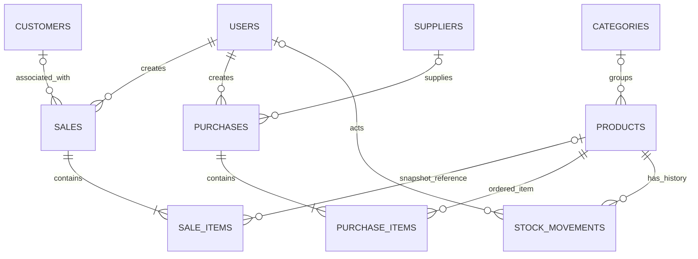

# SumYam Retail — Project Guide

**Developer / Maintainer:** Saurav Shah Teli
**Product:** A modern retail management and inventory operations platform

This guide explains what SumYam Retail does, how its modules connect, and where its current boundaries are. It describes the checked-in implementation rather than a proposed future version. For setup commands and the concise API matrix, begin with [README.md](README.md).

## 1. Project overview

SumYam Retail is a browser-based application for maintaining a store catalog, associating checkouts with customers, recording payment methods, ordering stock from suppliers, and auditing quantity changes. The live application uses a PHP JSON API and MySQL database. A separate static demo adapter can run without PHP or MySQL and stores its fictional activity in browser storage.

The repository uses a small, direct stack: HTML, CSS, vanilla JavaScript, PHP 8.2, PDO, and MySQL 8.4. The browser does not access MySQL directly; it requests PHP endpoints on the same origin.

## 2. What problem the product solves

Small retail teams often use unrelated tools for product lists, sales, supplier orders, and stock counts. Records can drift apart: a sale may not reduce inventory, a received delivery may be mistaken for an order, and staff may not be able to tell who adjusted a quantity.

The application provides shared operational records and connects important stock changes to the event that caused them. Its database-backed mode is designed for everyday store operations, while the demo is isolated for evaluation and interface familiarization.

## 3. Why the product was developed

The codebase brings together the core workflows needed to demonstrate a small retailer's operational cycle: catalog management, point-of-sale checkout, procurement, inventory movement, and simple reporting. It also demonstrates application engineering concerns that a purely client-side tool cannot enforce on its own, including server-side validation, authentication, role checks, unique constraints, transactions, row locking, and request idempotency.

The implementation remains deliberately smaller than a full enterprise resource planning system. It does not claim to provide accounting, tax configuration, payment settlement, or advanced demand forecasting.

## 4. Who the product is designed for

- Small and medium-sized retail businesses that need a central product and stock register.
- Store owners and managers who maintain products, suppliers, purchases, and stock controls.
- Retail staff who need read access to operational data and permission to process a checkout.
- Developers learning how a browser frontend can call a PHP API backed by a relational database.

The role checks are functional authorization rules, not merely different user-interface appearances. A hidden button does not replace an API permission check.

## 5. Real-world retail use cases

The modules can support use cases such as:

- An electronics shop looking up a SKU and seeing its stock relative to a reorder threshold.
- A stationery store recording a checkout against an existing customer or as a walk-in sale.
- A clothing store creating a supplier order while stock stays unchanged until the boxes arrive.
- A campus shop reviewing who adjusted stock and what the old and new quantities were.
- A manager reviewing completed-sale revenue and exporting the currently loaded catalog.

These are usage examples, not claims about actual customers or populated business data.

## 6. Complete feature encyclopedia

### Authentication

- **What:** Email/password login, active-account session checks, CSRF token delivery, and logout.
- **Why:** Business records and mutations must be associated with a valid account.
- **Who:** Administrators and staff; the first account is created through the command-line bootstrap script.
- **How:** The browser calls `api/auth.php`; PHP verifies a password hash and keeps the account ID in a secure session. The API reloads the user and role from `users` when authorizing requests.
- **Business benefit:** Store operations are attributable and access can be revoked by deactivating the user.

### Admin and staff permissions

- **What:** Two roles: `admin` and `staff`.
- **Why:** Reading operational information and changing store records are different responsibilities.
- **Who:** Admins manage records; both roles can read the modules and perform checkout.
- **How:** Shared authorization code checks the active database user and allowed role for every API request. The frontend also hides admin-only controls for clarity.
- **Business benefit:** Staff can complete routine sales without receiving administrative write access to catalog, purchasing, or stock controls.

### Dashboard

- **What:** A summary of products, categories, units, completed-sale revenue, retail-price inventory value, stock health, seven-day sales, recent sales, and reorder alerts.
- **Why:** Managers need a quick way to see current catalog and operational signals.
- **Who:** Signed-in admin and staff users.
- **How:** `api/analytics.php` calculates the values from MySQL; `index.js` renders the response in cards, a seven-day bar chart, an inventory-health graphic, alerts, and recent sales.
- **Business benefit:** A user can spot low stock and review completed sales without manually combining separate reports.
- **Boundary:** The dashboard does not show cost valuation because the code does not maintain a verified inventory costing basis.

### Product and category management

- **What:** Product search, category and stock filters, sorting, create/edit, deactivation, and stock adjustment. Categories can be listed and created.
- **Why:** The catalog is the common reference used by checkout, stock control, purchasing, and reporting.
- **Who:** Staff can read; administrators can make catalog changes.
- **How:** Product API writes validate prices and quantities, reject a duplicate SKU, resolve/create a category when supplied by name, and record initial or manually edited stock movements. Deactivation keeps historical invoice and inventory references.
- **Business benefit:** Store staff can locate items consistently by name/SKU and avoid selling a product that is inactive.
- **Boundary:** Category edit/delete routes are not implemented. Some category and product fields are string-based; there is no barcode scanner integration.

### Customer management

- **What:** Searchable contact records and completed-sale counts and spend totals.
- **Why:** A sale can be associated with a known customer and historical purchases can be summarized.
- **Who:** Staff can search/read; administrators can create, edit, and delete customer records.
- **How:** `api/customers.php` joins customers to completed sales. Checkout sends `customer_id`; the API verifies the customer exists and stores a customer-name snapshot with the sale.
- **Business benefit:** Customer-linked invoices and purchase summaries are available without treating walk-in customers as a required database record.

### Supplier management

- **What:** Supplier contact details with purchase-order counts and received-order totals.
- **Why:** Purchase orders need a supplier contact and managers need to locate vendors.
- **Who:** Staff can search/read; administrators can maintain supplier records.
- **How:** `api/suppliers.php` stores supplier and company fields and aggregates linked purchase records. The PO stores a supplier name snapshot and an optional supplier foreign key.
- **Business benefit:** Purchase history remains readable even when the supplier's current contact record changes.
- **Boundary:** There is a confirmed legacy display issue: the API returns a `products` compatibility field using a synthetic fallback/count-derived value; the frontend may display it when the actual PO count is zero. It must not be treated as a verified metric. The API behavior is documented here but was not changed during this documentation task.

### Sales and POS billing

- **What:** Product picker, cart, customer selection, payment-method selection, discount, tax, checkout, sales history, invoice lookup, and browser printing.
- **Why:** The point of sale ties product quantities and customer association to a transaction.
- **Who:** Admin and staff users with a valid session.
- **How:** `index.js` submits item IDs/quantities, an optional `customer_id`, payment method, discount, notes, and an idempotency key. The API reloads product prices, aggregates duplicate product IDs, locks the relevant rows, validates status and stock, calculates totals, inserts a completed sale and lines, reduces stock, writes audit rows, and commits once all operations succeed.
- **Business benefit:** A successful checkout produces a retrievable invoice and a corresponding inventory trail.
- **Boundaries:** Payment method is recorded as a value; no payment terminal, gateway, settlement, refund, or chargeback integration exists. The tax rate is fixed at 5% in the API. There is no sale void/refund endpoint even though the schema's status enum includes `voided`.

### Purchase order lifecycle

- **What:** Creation/listing/detail of supplier purchase orders and separate confirmation of physical receipt.
- **Why:** Placing an order is not the same as goods arriving at the store.
- **Who:** Admins can create and receive purchase orders; both roles can view them.
- **How:** The POST operation creates an `ordered` PO and snapshots item cost/quantity without touching stock. A separate PUT request with `action: "receive"` validates and receives the whole order.
- **Business benefit:** Inventory increases only after a user confirms delivery.
- **Boundaries:** Receipt is all-or-nothing. Partial receipt, cancellation, supplier payment, and backorder workflows are not implemented, although `cancelled` exists in the database status enum.

### Inventory and stock control

- **What:** Current quantities, minimum stock levels, healthy/low/out-of-stock status, and stock adjustments.
- **Why:** A central count helps prevent selling unavailable goods and identifies restock needs.
- **Who:** Both roles can read stock views; only administrators can adjust quantities.
- **How:** Dashboard and inventory rendering use active product quantities. API adjustments lock the product row, reject a negative resulting balance, update the quantity, and write a movement attributed to the acting user.
- **Business benefit:** Stock changes are tied to an operator and a before/after count.

### Stock adjustment and audit

- **What:** Manual adjustments plus a chronological stock movement view.
- **Why:** Managers need a traceable reason for quantity changes.
- **Who:** Admins adjust; admin and staff can inspect the audit log.
- **How:** `stock_movements` records movement type, signed quantity change, previous/new balances, optional user, reference, notes, and timestamp. Sales, received purchase orders, initial product stock, and manual adjustments create movements in their transaction.
- **Business benefit:** Stock history can be reconciled to business actions rather than only comparing current totals.
- **Boundary:** The application does not expose a separate movement-edit/delete interface. Database-level privileged operators could still change data, so immutability is an application convention rather than an enforced append-only database permission model.

### Analytics and reports

- **What:** Completed-sale revenue/order counts, average bill, today's totals, seven-day trend, top products, category distribution, recent completed sales, and stock alerts.
- **Why:** Managers need a compact view of operational performance.
- **Who:** Admin and staff users.
- **How:** The API aggregates from `sales`, `sale_items`, `products`, `categories`, and `customers`; the UI shows empty states when aggregate lists contain no rows.
- **Business benefit:** Teams can review their own recorded data without loading external analytics services.
- **Boundaries:** `gross_profit_estimate` is explicitly unverified and based on cost snapshots stored on sale items. `gross_profit` is null. Inventory cost value is null because purchase receipts do not maintain product cost prices. There is no forecast endpoint or fabricated forecast result.

### Data export

- **What:** JSON export of the currently loaded products, categories, customers, suppliers, and sales; CSV export of the currently loaded product catalog.
- **Why:** Staff may need a local snapshot for review or transfer to another tool.
- **Who:** Signed-in users who can load the underlying data.
- **How:** The browser serializes loaded frontend state into a downloaded file. CSV includes the catalog ID, name, SKU, category, cost/selling price, stock, minimum stock, unit, and status.
- **Business benefit:** A user can retain a local snapshot without an export service.
- **Boundaries:** This is not a scheduled backup, and export scope follows the currently loaded data. Treat exported files as sensitive business data.

## 7. Authentication and user roles

The `users` table stores unique email, display name, password hash, role, and active status. `bin/create-user.php` is CLI-only; it accepts the role `admin` or `staff`, validates a 12-to-1024-byte password, and stores `password_hash()` output. There is no browser-based account-management screen.

Live page initialization requests `auth.php?action=session`. If unauthenticated, the UI shows the login gate. On login, the API validates the email/password, checks active status, rotates the PHP session ID, and issues a random CSRF token. Mutating APIs verify the token and same-origin request. Logout clears session data and expires the cookie. Session lifetime otherwise follows PHP's server/session configuration; the app does not implement its own idle timeout policy.

| Capability | Admin | Staff |
|---|---:|---:|
| Read products, categories, customers, suppliers, sales, purchases, stock, analytics | Yes | Yes |
| Create or edit/deactivate catalog/customer/supplier records | Yes | No |
| Create purchase order or confirm receipt | Yes | No |
| Adjust stock manually | Yes | No |
| Complete a sale | Yes | Yes |

Each endpoint defines its own allowed methods. Categories only support list/create; the method matrix is summarized in [README.md](README.md#api-reference).

## 8. Dashboard explanation

The dashboard combines values from a single analytics API response. Product and stock totals include active products. Revenue includes sales whose status is `completed`. The seven-day trend uses the current date and six prior days. Recent sales are the latest five completed records. Reorder alerts include active products whose quantity is less than or equal to their minimum threshold.

The inventory chart visualizes healthy, low, and out-of-stock product counts. The report profit card carries an approximation marker until costing policy is verified. If the database returns no sales, product-ranking lists remain empty rather than being filled with sample transactions in live mode.

## 9. Product and category management

Product rows include category, SKU, optional barcode, cost price, selling price, current stock, minimum stock, unit, and active/inactive status. SKU uniqueness is enforced in the schema. Product search matches name, SKU, barcode, or category; list filters include category and stock state, with a server-side sorting whitelist.

Initial stock greater than zero is accompanied by an `INITIAL` movement. Editing a product's stock creates an `ADJUSTMENT_ADD` or `ADJUSTMENT_SUB` record. Deleting through the API changes status to `inactive`, preserving references and history. Checkout checks that a product remains active.

Categories have a unique name, description, and creation timestamp. The API lists them with associated product count and total units and permits administrator creation. It currently has no category update/delete endpoint.

## 10. Customer management

Customer records store name, phone, optional email/address, and creation time. Search includes name, phone, email, and address. The customer list calculates the count of completed linked sales and total spend. These values are derived from sale rows and are not copied into mutable customer summary fields.

If a checkout uses a customer ID, the sale API locks and verifies that customer and records both its ID and name snapshot. If no ID is selected, the sale is stored as `Walk-in Customer` with a null customer foreign key. When a customer row is deleted, the schema sets historical `sales.customer_id` to null while retaining the sale's stored name.

## 11. Supplier management

Supplier rows store contact name, company, phone, optional email/address, and creation time. Search covers company/contact and phone/email. The supplier list reports PO count and the value of received purchase orders.

The schema stores a supplier ID and a supplier-name snapshot on each purchase. Deleting a supplier nulls the optional supplier ID; historical purchase display can still use the saved name. The current compatibility `products` field is not a trustworthy count; see the documented limitation in the supplier feature entry.

## 12. Sales and POS billing

The cart is assembled in the browser, but the browser's submitted price values are not authoritative. The live sales API accepts a UUID idempotency key, line items (`id`/`product_id` and `qty`/`quantity`), optional customer ID, discount, payment method, and notes. The API rejects empty carts, invalid quantities, unknown/inactive products, insufficient stock, unsupported payment methods, and excessive notes.

Duplicate lines for one product are aggregated, product IDs are sorted before locking, and each database selling price is used for the calculation. The total discount is capped at the subtotal. Tax is currently calculated at a fixed 5% on the discounted amount. The completed sale stores date, payment method, totals, current user, optional customer ID, customer-name snapshot, notes, and a server-generated unique invoice number. Sale line items store product-name/SKU/price/cost snapshots.

After a successful transaction the browser can retrieve the invoice, show its current customer and item details, and open the print dialog. The invoice is generated in the browser and is not an official tax-compliance certificate; tax configuration and jurisdictional requirements are outside the current implementation.

## 13. Purchase order lifecycle

The lifecycle is `ordered` → `received` in the implemented workflow. `cancelled` is allowed by the schema enum but no cancellation API action exists.

1. Create the order with supplier, item quantities, optional unit costs, notes, and an idempotency key.
2. The API aggregates duplicate product lines and rejects repeated lines whose explicit unit costs conflict.
3. The API uses explicit submitted unit cost when supplied; otherwise it snapshots the product's existing `cost_price`.
4. It stores the PO and items with `received_quantity = 0`; inventory remains unchanged.
5. When goods physically arrive, an administrator confirms receipt through `PUT api/purchases.php` with `{ "id": <purchase-id>, "action": "receive" }`.
6. The API receives the complete order, records quantities and actor-attributed `PURCHASE` movements, and changes the PO to `received`.

Repeated receipt requests return an already-received result and do not add stock twice. There is no partial receipt, shortage, damaged-item, invoice-payment, or return workflow.

## 14. Inventory and stock control

`products.stock_quantity` is the current count. `min_stock_level` defines the reorder alert boundary. Active items are grouped into healthy (above minimum), low (positive but at/below minimum), and out-of-stock (zero) counts. Inactive items are not offered at POS and are omitted from active-product analytics.

Inventory is changed by sale deduction, purchase receipt, or administrator adjustment. All implemented mutation paths use a transaction and write a movement record in the same transaction. Purchase creation alone never changes stock.

## 15. Stock adjustment and audit

An administrator can submit either a signed difference (`delta`) or a target stock quantity (`stock`/`new_stock`). The stock API locks the product row, computes the resulting quantity, rejects negative stock, updates the product, and writes an audit row with the actor ID. Product edit can also change stock and journals its difference.

The stock audit endpoint supports filtering by product and a bounded result limit. Records are displayed newest-first by movement ID, with product name/SKU, movement type, signed change, previous and new stock, reference, notes, and timestamp. The movement table's foreign key protects product history from deletion; if a user is removed, the actor reference becomes null.

## 16. Analytics and reports

`api/analytics.php` returns:

- active-product count, total units, and inventory retail-price value;
- category and customer counts;
- completed-sale total revenue, number of completed sales, average bill, and today's revenue/order count;
- seven daily values for sales revenue and order count;
- up to six top-selling product snapshots;
- active catalog distribution by category;
- the latest five completed sales;
- all current active products at or below reorder threshold.

Revenue and charts use completed sales only. Voided rows, if any, do not contribute. The API reports `gross_profit: null`, a separate unverified estimate, and explicit limitation text. `inventory_cost_value` is also null/unverified because received purchase prices are not used to maintain the product cost basis. No forecast result is generated.

## 17. Data export

JSON export includes a timestamp, product system label, maintainer label, and the frontend's currently loaded products, categories, customers, suppliers, and sales. CSV contains the loaded products. The UI creates downloads locally with no export endpoint.

Exports can contain customer, supplier, price, or sales information. Store them securely and use database backups for actual backup/restore needs. No restore/import workflow is implemented for these exports.

## 18. Static demo versus live database

The demo adapter is loaded before the application script. The internal flag `SMARTSTORE_DEMO_MODE` controls routing: live mode calls relative PHP endpoints using same-origin credentials, while demo mode calls the browser adapter. Existing global names and local-storage keys retain their old `SmartStore` spelling to avoid breaking compatibility; they do not change the visible SumYam Retail name.

The static adapter contains fictional products, categories, customers, suppliers, and example sale activity. Changes are saved in browser `localStorage` when available and otherwise exist only in page memory. It does not share records with another browser or write to MySQL. A static demo is for exploration only and should never be used as a store's source of truth.

The live backend does not switch to fictional records on a network or database error. It returns an error to the UI. `api/fake-api.php` and `api/setup.php` are intentionally disabled in live mode with HTTP 410 responses.

## 19. Detailed application architecture

### Browser layer

`index.html` defines the application shell, section IDs, form controls, modal, login gate, and toast/invoice containers. `style.css` supplies the responsive/light/dark design system. `index.js` stores page state, renders API data, handles navigation and forms, submits requests, and performs browser exports/printing. The static adapter is an optional data source; it does not replace the application renderer.

### HTTP/API layer

Each PHP file under `api/` is a direct controller for one resource/workflow. Requests and responses are JSON. Shared helpers in `helpers/response.php` configure response headers, decode request bodies, start sessions, validate same-origin and CSRF headers, load active users, enforce roles, and log exceptions. There is no separate framework router or ORM.

### Persistence layer

`config/database.php` reads the database environment, validates the timezone, and creates a singleton PDO connection with exception mode, associative fetch mode, native prepared statements, `utf8mb4`, and UTC session time. SQL is written directly in the API files and uses prepared statements for incoming values.

### Static demo layer

`static-demo.js` owns its own in-memory store and optional local-storage key. It is selected only by its existing static-host detection or explicit `?demo=1`. No server-side demo fixture is imported into the live database.

### Operational tools

`bin/create-user.php` creates an account from a CLI process. `database/migrations/001_initial_schema.sql` creates schema in an empty, already-created database. `tests/integration.php` starts its own short-lived PHP server for actual HTTP requests against the isolated test database.

## 20. Complete database explanation

The migration contains 11 tables, each using InnoDB and `utf8mb4_unicode_ci`. Numeric identifiers are unsigned auto-incrementing `BIGINT` except `login_attempts`, whose IP address is its primary key. Prices and totals are fixed-precision `DECIMAL`; stock quantities use integer columns. The schema includes indexes for catalog lookup, stock status, sale/purchase dates and relationships.

The schema separates transaction headers from their item lines. Sales and purchase lines retain a product name and price/cost snapshot, so the historical document remains understandable if the catalog changes. Stock movements are a separate journal referencing the product and optional acting user. Unique indexes support SKU/email/category/invoice/PO and per-user idempotency enforcement.

The migration does not create `smartstore_db`, create a MySQL user, insert a first admin, or seed any business data. The application database must be created and selected first. The same migration is applied to `smartstore_test` only by a database administrator preparing the disposable test environment.

## 21. Table-by-table database documentation

### `users`

`id` (primary key), `email` (unique), `display_name`, `password_hash`, `role` (`admin`/`staff`), `is_active`, `created_at`, and `updated_at`. Login and API authorization require an active row.

### `login_attempts`

`ip_address` (primary key), `attempt_count`, and `window_started_at`. Login code locks this row while checking/updating failed-attempt state.

### `categories`

`id`, unique `name`, optional `description`, and `created_at`. Products can refer to a category; deleting the category preserves the product by nulling the reference.

### `products`

`id`, nullable `category_id`, `name`, unique `sku`, nullable `barcode`, `cost_price`, `selling_price`, `stock_quantity`, `min_stock_level`, `unit`, `status` (`active`/`inactive`), `created_at`, and `updated_at`. Foreign key: `category_id → categories.id ON DELETE SET NULL`.

### `customers`

`id`, `name`, `phone`, nullable `email`, nullable `address`, and `created_at`. Name and phone indexes support common lookups; phone/email are not declared unique.

### `suppliers`

`id`, contact `name`, `company`, `phone`, nullable `email`, nullable `address`, and `created_at`. Company has a lookup index; supplier identity fields are not declared unique.

### `sales`

`id`, nullable-while-created `invoice_no`, `idempotency_key`, `user_id`, nullable `customer_id`, `customer_name`, subtotal, discount, tax rate/amount, grand total, payment method, status (`completed`/`voided`), notes, sale date, and creation time. Unique constraints cover invoice number and `(user_id, idempotency_key)`. User deletion is restricted; customer deletion nulls the reference.

### `sale_items`

`id`, `sale_id`, nullable `product_id`, product name, SKU, unit price, cost snapshot, quantity, subtotal, and line discount. Deleting a sale cascades to its lines; deleting a product nulls the line's optional product reference.

### `purchases`

`id`, nullable-while-created `po_number`, idempotency key, `created_by`, nullable supplier ID, supplier name snapshot, total amount, status (`ordered`/`received`/`cancelled`), notes, purchase date, nullable `received_at`, and creation time. Unique constraints cover PO number and `(created_by, idempotency_key)`. User deletion is restricted; supplier deletion nulls the reference.

### `purchase_items`

`id`, `purchase_id`, `product_id`, product name snapshot, unit cost, ordered quantity, `received_quantity` (starts at zero), and subtotal. PO deletion cascades to lines; product deletion is restricted while lines refer to it.

### `stock_movements`

`id`, `product_id`, nullable `user_id`, movement type (`INITIAL`, `SALE`, `PURCHASE`, `ADJUSTMENT_ADD`, `ADJUSTMENT_SUB`), signed integer quantity, previous/new stock, reference ID, notes, and creation timestamp. Product deletion is restricted; user deletion nulls the actor reference.

## 22. Database relationships

`||` means one required parent; `o|` indicates the child's reference can be optional where the schema allows `NULL`. Cascading, set-null, and restrict rules are listed in [Database architecture](#20-complete-database-explanation) and above in the relationship list.

## 23. Authentication and security architecture

The browser uses `credentials: 'same-origin'`. `startSecureSession()` enables strict mode and cookie-only sessions, names the session cookie `smartstore_session`, and sets HTTP-only/SameSite attributes. The secure flag depends on HTTPS. Login requires a same-origin request and uses `password_verify`; success regenerates the session identifier and creates a random CSRF token.

For a business write, `requireApiRole()` loads the active user, checks the allowed role, verifies request origin/host/scheme, and checks `X-CSRF-Token` with `hash_equals`. GET requests do not require CSRF. Logout validates same-origin and CSRF before clearing session data and expiring the cookie. The `status.php` endpoint is public and returns only a minimal health result.

The login-attempt table limits repeated failures by remote IP. Error details go to server logs rather than API responses. This code does not define a robust public-host deployment profile, password reset, MFA, automated security headers policy beyond its current API headers, or an audit policy for user administration. Review those areas before a public production launch.

## 24. Sales transaction integrity

Checkout rejects a missing/invalid UUID, empty cart, invalid quantity, inactive/nonexistent product, invalid customer, unsupported payment method, or insufficient stock. It consolidates duplicate product lines by ID and sorts IDs before taking product locks. The customer and products are selected with `FOR UPDATE`, so a concurrent checkout must re-check the current row state after lock acquisition.

The API uses `selling_price` and `cost_price` from the locked product row, not the prices sent by the browser. It caps total discount at subtotal, computes a fixed 5% tax on the post-discount amount, inserts a `completed` sale and line snapshots, generates an invoice number from date plus inserted sale ID, deducts stock, and inserts one `SALE` movement for each aggregated product. These writes commit as one transaction; exceptions roll back the in-flight work.

An invoice unique index protects numbering. The unique `(user_id, idempotency_key)` index prevents the same user/key from creating two sales. If a concurrent duplicate request reaches the unique constraint, the API looks up and returns the existing sale. The schema allows `voided`, but there is no implemented void operation or reversal movement workflow.

## 25. Purchase transaction integrity

Order creation requires an admin, supplier, nonempty valid item list, notes within the configured limit, and a UUID idempotency key. Duplicate product lines aggregate; explicit costs must agree across duplicate lines. The API sorts the product IDs, locks supplier and product rows, chooses an explicitly supplied unit cost or the current product cost, computes line/order totals, inserts an `ordered` purchase and item snapshots, and commits. It does not update product stock or product cost price.

Receipt is a separate admin-only PUT operation. It locks the purchase row and item set, rejects a PO that is missing or in a non-ordered state, and locks products as it applies each full line quantity. In the same transaction it updates stock, inserts `PURCHASE` movement records, sets each received quantity to its ordered quantity, sets PO status to `received`, and records `received_at`. If a stock update or audit insert fails, the exception path rolls the transaction back. A previously received PO returns without duplicate stock change.

The implementation does not support receiving only part of an order, modifying an ordered PO, or cancelling a PO. Although the database permits `cancelled`, no API path moves a purchase into that status.

## 26. Stock locking and transaction rollback

Manual adjustment selects a product using `FOR UPDATE`, calculates the new quantity, rejects negative stock, updates `products`, and writes a user-attributed movement before commit. Product editing also locks the row and writes a movement if stock was changed. Checkout and receipt use transactions for larger multi-table state changes.

InnoDB is required for the transaction/row-lock design. A failed line write should not leave a sale without its stock movement or a received purchase whose inventory was only partly updated. The isolated integration suite includes strict-mode overflow cases for rollback and skips those cases if MySQL would clamp rather than reject the values.

## 27. Idempotency and duplicate-request protection

The browser generates a UUID for checkout and purchase creation and retains a pending key with a payload signature in session storage so a retry of the same pending payload reuses the key. A different payload gets a new key. On success, the frontend clears the corresponding pending key.

The API requires a UUID and uses unique constraints scoped to the acting user (`user_id` for sales, `created_by` for purchases). A repeat lookup returns the original sale/PO rather than duplicating the business operation. Receipt has state-based protection: once the purchase is `received`, a subsequent receipt request reports already received and does not add stock again.

These mechanisms protect retries of the same operation. They do not provide a general request ledger or guarantee that arbitrary changed payloads are treated as the same business event.

## 28. Technology choices and engineering decisions

- **Vanilla frontend:** keeps the application dependency-free and makes the request/rendering flow visible in the source.
- **Direct PHP endpoints:** each domain API has a focused file; shared response/session/CSRF/role helpers are centralized.
- **PDO and prepared statements:** parameter values are bound; sorting uses a fixed whitelist where SQL identifiers cannot be parameterized.
- **MySQL/InnoDB:** foreign keys protect relationships and row locks protect critical stock updates.
- **Denormalized snapshots in sale/purchase lines:** preserve the name and price/cost presented at transaction time even if the catalog changes later.
- **Two-mode frontend:** static exploration remains usable without backend infrastructure while live mode continues to treat API responses as authoritative.
- **No ORM or migration framework:** schema changes are SQL files applied by an operator; API queries are direct SQL in PHP.

## 29. Testing architecture and 25-test reported result

The integration runner uses the real PHP API endpoints over HTTP, the normal authentication/session/CSRF/role code, a dedicated test database, and run-specific fixtures. Its entry point refuses any configured database name other than `smartstore_test` and independently checks `SELECT DATABASE()` before creating fixtures. It checks the required migration tables and obtains a MySQL advisory lock before proceeding.

The 25 implemented result checks cover:

1. the HTTP status API;
2. invalid credentials;
3. admin login and CSRF token delivery;
4. authenticated session identity and role;
5. rejection of a missing CSRF token;
6. an admin write reaching endpoint validation;
7. checkout with duplicate lines and a customer;
8. stored customer association and server-side prices/totals;
9. aggregated stock deduction;
10. actor-attributed sale movement;
11. repeated checkout idempotency;
12. insufficient-stock rejection without side effects;
13. failed checkout rollback (strict SQL mode only);
14. purchase creation aggregation without stock changes;
15. repeated purchase idempotency;
16. staff login;
17. staff read permission;
18. staff write denial;
19. staff receipt denial;
20. explicit admin receipt and stock update;
21. actor-attributed purchase movement;
22. repeated receipt does not duplicate inventory;
23. failed receipt rollback (strict SQL mode only);
24. expired session becomes unauthenticated;
25. logout invalidates the session.

The last two transaction-overflow checks are conditionally skipped if global MySQL SQL mode is not strict. The previous project run was reported as **25 passed, 0 failed**. That result is documented as a prior report, not a result from this rebranding task. The runner removes only linked test fixtures in `smartstore_test`, restores the pre-run loopback login-attempt row, and removes its temporary session files. It never grants test access to `smartstore_db` by itself; database account grants must also be scoped correctly.

The test database must be created and migrated separately. Use the DML-only test account described in [tests/README.md](tests/README.md). Never point the runner at the live business database. Tests are not a substitute for a deployment backup and recovery plan.

## 30. Installation overview

The complete macOS/Homebrew instructions, database creation and migration commands, secure runtime grants, admin bootstrap environment, and local PHP server command are in [README.md — Installation and setup](README.md#installation-and-setup). In brief:

1. Install PHP 8.2 with `pdo_mysql` and MySQL 8.4.
2. Create a new empty `smartstore_db` with `utf8mb4`.
3. Apply `database/migrations/001_initial_schema.sql` with a migration account that can create tables and foreign keys.
4. Export the exact `DB_*` variables and run `php bin/create-user.php` with the bootstrap variables.
5. Start `php -S 127.0.0.1:8080 -t .` in that configured environment and open the local URL.

There is no `.env` loader. Do not paste real credentials into documentation, source control, shell command history, or public issue reports.

## 31. Current technical limitations

- Tax is fixed at 5%, not configured by jurisdiction or tax category.
- A payment method is saved but no funds are captured or reconciled.
- Product cost price is not updated from received purchase costs; inventory cost valuation is unavailable.
- Gross profit is an unverified estimate from historical sale cost snapshots.
- The supplier compatibility `products` display can contain a synthetic value and is not trustworthy.
- There is no sale cancellation/void/refund flow, purchase cancellation API, partial receipt, or return handling.
- Category management lacks update/delete endpoints.
- User management is CLI-only; there is no password reset or MFA workflow.
- No pagination is provided for the primary product/customer/supplier lists; sales and audit are bounded by limits.
- The report export uses currently loaded frontend state, not a server-side archival export.
- The local PHP development server and repository do not provide a hardened production hosting configuration, monitoring, backup/restore, or disaster-recovery system.
- Browser visual testing was not available during the most recent presentation redesign session because the local server was not reachable in that session.

## 32. Future development roadmap

Possible next steps, not implemented features:

1. Fix supplier count semantics and add regression coverage for empty supplier history.
2. Add configured tax rules and a reviewed monetary rounding policy.
3. Maintain inventory cost basis on receipt and define FIFO/weighted-average accounting before labeling gross profit as verified.
4. Add partial receipt and PO cancellation workflows with transactional tests.
5. Add a documented sale void/refund workflow with compensating stock movements and authorization.
6. Add browser-based user administration, password reset, MFA, and audit coverage for account changes.
7. Add pagination, server-side export limits, backups, restore drills, monitoring, and a production deployment guide.
8. Add end-to-end browser tests for supported desktop/tablet/mobile layouts and keyboard navigation.

These are proposals for future work and should not be presented as current capabilities.

## 33. How beginners can understand and extend the system

Start with the data path:

1. Find a control and its stable ID in `index.html`.
2. Find the event listener and renderer in `index.js`.
3. Follow the request through the `API` helper, noting same-origin credentials, CSRF header, and JSON body.
4. Open the matching endpoint under `api/` and identify validation, role requirements, and database writes.
5. Trace table/foreign-key definitions in the migration.
6. For stock-changing workflows, follow the whole transaction and its `stock_movements` writes.
7. Add or change tests only with `DB_NAME=smartstore_test`; never experiment against business data.

For a UI-only change, keep current IDs, `data-section`, `data-navigate`, field names, and modal hooks. For a database change, add a reviewed migration instead of editing an applied migration in place. Document new environment variables and never add real secrets. Keep demo fixtures inside the static adapter; do not copy them into live schema setup.

## 34. Developer and maintenance information

**Current maintainer:** Saurav Shah Teli.
**Primary entry points:** `index.html`, `index.js`, `api/`, `config/database.php`, `database/migrations/`, and `tests/integration.php`.
**Local setup:** macOS/Homebrew path documented in [README.md](README.md).
**Database identifiers retained for compatibility:** `smartstore_db` and `smartstore_test`.
**Internal legacy names retained for compatibility:** `SMARTSTORE_DEMO_MODE`, `SmartStoreDemo`, `smartstore_session`, and `smartstore_*` storage/log names.

There is no explicit third-party dependency manifest and no `LICENSE` file. No previous repository/deployment URL or student/course identifier is needed to build the application. Keep any attribution or license notice that is later found to apply to imported code or assets; do not imply that this maintenance identity changes original authorship.

## 35. Final product summary

SumYam Retail connects day-to-day catalog, checkout, purchase, inventory, and reporting tasks through a browser frontend, PHP APIs, and a relational database. Transactions, row locks, unique idempotency keys, and stock-movement records support the integrity of key live workflows. The isolated static demo supports exploration without writing fictional records to the live database.

The core application is implemented, but this documentation does not make it production-certified. Tax, cost accounting, user lifecycle, partial receiving, refunds, and public deployment hardening remain outside the current feature set. The maintainer should address those boundaries before relying on the application for regulated billing or business-critical deployment.
