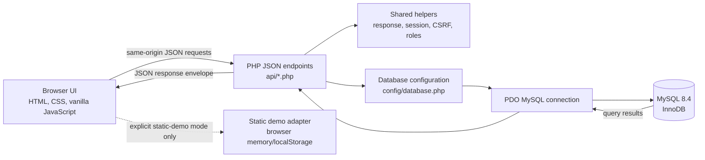

# SumYam Retail

**Retail management and inventory operations, in one focused workspace**

**Developer / Maintainer:** Saurav Shah Teli
**Status:** Core live workflows and a browser-only static demo are implemented. The isolated HTTP integration suite contains 25 checks; a prior run was reported as 25 passed. This documentation and rebranding work did not rerun the database suite. The application has not been independently security-audited or certified for production use.

SumYam Retail is a modern retail management and inventory operations platform for catalog, checkout, purchasing, stock control, and reporting.

**Technology:** HTML, CSS, vanilla JavaScript, PHP 8.2, PDO, and MySQL 8.4.

## Contents

1. [Introduction](#introduction)
2. [Key features](#key-features)
3. [Target users](#target-users)
4. [Technology stack](#technology-stack)
5. [System architecture](#system-architecture)
6. [Database architecture](#database-architecture)
7. [Main workflows](#main-application-workflows)
8. [Project structure](#project-structure)
9. [Installation and setup](#installation-and-setup)
10. [Environment variables](#environment-variables)
11. [Authentication and security](#authentication-and-security)
12. [API reference](#api-reference)
13. [Automated testing](#automated-testing)
14. [Live mode and static demo](#live-mode-and-static-demo)
15. [Limitations and roadmap](#limitations-and-roadmap)
16. [Troubleshooting](#troubleshooting)
17. [Contributing](#contributing-and-development-guidelines)
18. [Additional documentation](#additional-documentation)
19. [License](#license)

## Introduction

Retail teams often keep product lists, stock counts, supplier orders, and sales in separate spreadsheets or paper records. That makes it difficult to know what is available, connect a sale to a customer, or explain why stock changed.

SumYam Retail brings those daily tasks into one application. In live mode, a PHP API uses MySQL as the source of truth. Checkout and purchase receipt update inventory together with their associated records and stock-movement history. A separate static demo supports interface exploration using fictional data stored only in the current browser.

## Key features

- **Authentication:** email/password sign-in, secure PHP sessions, a session check on startup, CSRF tokens for writes, logout, and database-backed throttling for repeated failed logins.
- **Admin and staff permissions:** both roles can read operational data and complete checkout. Admin-only writes include catalog, customer, supplier, purchase-order, receipt, and stock changes. API authorization enforces these rules independently of hidden UI controls.
- **Dashboard:** database-derived product, category, unit, revenue, inventory retail-value, stock-health, seven-day sales, recent-sales, and reorder-alert summaries. Cost valuation is explicitly unavailable until a costing basis is maintained.
- **Products:** create, read, update, filter, sort, search, deactivate, and adjust stock. Product stock edits create audit movements. Inactive products are excluded from checkout.
- **Categories:** list categories with product and unit counts; administrators can add categories. Product entry can also resolve or create a category by name.
- **Customers:** searchable contact records and purchase totals derived from completed sales; administrators can add, edit, and delete customer records.
- **Suppliers:** searchable vendor/contact records and purchase-order summaries; administrators can add, edit, and delete suppliers.
- **Sales and POS billing:** select products and an optional customer, choose a recorded payment method, apply a discount, and submit checkout. The server recalculates prices from the catalog, validates stock, persists the sale and line items, deducts stock, and records movements in one transaction. A request idempotency key protects retries.
- **Invoices:** retrieve invoice details by ID or invoice number and print a browser-formatted invoice. Payment is recorded as a method; no payment gateway is connected.
- **Purchase orders:** administrators create an `ordered` purchase with line items and an idempotency key. Creating the order does not change inventory.
- **Explicit purchase receipt:** an administrator confirms physical receipt with a separate request. Full receipt updates stock, line receipt quantities, PO status, and audit movements in a transaction. Repeating receipt does not add stock again.
- **Inventory:** health counts, reorder thresholds, product-level stock adjustments, and inactive-product status.
- **Stock movement audit:** chronological records of initial stock, sales, purchase receipts, and manual adjustments, including the acting user when available, quantity delta, prior/new stock, reference, and timestamp.
- **Reports and exports:** completed-sale revenue, a clearly unverified gross-profit estimate, inventory retail value, stock alerts, top products, category distribution, recent sales, JSON export of loaded business collections, and CSV export of the loaded product catalog.
- **Static demo:** an explicitly separate, fictional browser-side adapter for trying the interface. It does not call live PHP endpoints or write demo rows to MySQL.

## Target users

The application is intended for small and medium-sized retailers, including grocery, electronics, clothing, stationery, and campus stores. Store managers can maintain the catalog, purchasing, and stock controls; staff can look up records and process sales within the permissions enforced by the API.

## Technology stack

| Technology | Purpose |
|---|---|
| HTML5 | Semantic application shell, forms, tables, and dialogs |
| CSS3 | Responsive design system, light/dark themes, print styles, and reduced-motion support |
| Vanilla JavaScript (ES6+) | Browser state, rendering, form handling, same-origin HTTP requests, and static-demo adapter integration |
| PHP 8.2 | JSON API endpoints, validation, authentication, authorization, and transaction orchestration |
| PDO with `pdo_mysql` | Parameterized MySQL access with exception-based error handling |
| MySQL 8.4 / InnoDB | Persistent records, unique constraints, foreign keys, row locks, and transactions |
| Browser `localStorage` | Static-demo persistence and the user's theme preference; not live business storage |
| Node.js (optional) | JavaScript syntax checks only; the application has no Node package dependencies |

The frontend uses system fonts and local assets. There is no frontend framework, package manager manifest, or third-party runtime library in the project.

## System architecture



Live requests use the PHP APIs and configured MySQL database. Static demo requests are routed to `window.SmartStoreDemo` by the existing compatibility flag `SMARTSTORE_DEMO_MODE`; that adapter is browser-local. The application does not fall back to demo data after a live API error.

## Database architecture

The migration at `database/migrations/001_initial_schema.sql` creates 11 InnoDB tables in an already-created empty database. It contains schema definitions only: no database creation, demo records, or destructive `DROP`, `TRUNCATE`, or `DELETE` statements.

| Table | Purpose and important constraints |
|---|---|
| `users` | Admin/staff accounts, active flag, password hash; unique email. |
| `login_attempts` | Per-IP failed-login counter and 15-minute window. |
| `categories` | Unique category names and optional descriptions. |
| `products` | SKU-unique catalog, nullable category, prices, stock, reorder threshold, unit, and active/inactive status. Category deletion sets `category_id` to `NULL`. |
| `customers` | Customer name and contact details. Sales retain a customer-name snapshot; deleting a customer nulls the optional sale reference. |
| `suppliers` | Supplier/company contact details. Deleting a supplier nulls the optional PO supplier reference. |
| `sales` | Invoice, user/customer association, totals, payment method, status, and idempotency key. Invoice numbers and `(user_id, idempotency_key)` are unique. User deletion is restricted; customer deletion sets the reference to `NULL`. |
| `sale_items` | Sale line snapshots for product name, SKU, price, cost, quantity, subtotal, and line discount. Sale deletion cascades; product deletion sets the optional reference to `NULL`. |
| `purchases` | Supplier-name snapshot, PO total/status, creator, receipt time, and idempotency key. PO numbers and `(created_by, idempotency_key)` are unique. User deletion is restricted; supplier deletion sets the reference to `NULL`. |
| `purchase_items` | Ordered and received quantities, product snapshot, unit cost, and subtotal. PO deletion cascades; product deletion is restricted. |
| `stock_movements` | Movement type, signed quantity delta, previous/new stock, actor, reference, notes, and timestamp. Product deletion is restricted; user deletion sets the actor reference to `NULL`. |

The foreign-key relationships are:

- `products.category_id → categories.id` (`ON DELETE SET NULL`).
- `sales.user_id → users.id` (`RESTRICT`) and `sales.customer_id → customers.id` (`SET NULL`).
- `sale_items.sale_id → sales.id` (`CASCADE`) and `sale_items.product_id → products.id` (`SET NULL`).
- `purchases.created_by → users.id` (`RESTRICT`) and `purchases.supplier_id → suppliers.id` (`SET NULL`).
- `purchase_items.purchase_id → purchases.id` (`CASCADE`) and `purchase_items.product_id → products.id` (`RESTRICT`).
- `stock_movements.product_id → products.id` (`RESTRICT`) and `stock_movements.user_id → users.id` (`SET NULL`).

The default live database name in configuration is `smartstore_db`. The isolated test database must remain `smartstore_test`; neither identifier is a display brand and neither should be renamed as part of rebranding.

## Main application workflows

1. **Authentication:** the browser requests `auth.php?action=session`. A signed-out user sees the login form. Login posts credentials to `auth.php?action=login`; a successful response returns user identity and a CSRF token. Mutating requests send that token in `X-CSRF-Token`. Logout posts to `auth.php?action=logout` and destroys the session.
2. **Product creation:** an administrator submits product fields. The API validates prices and quantities, resolves an optional category name, stores the product, and journals a nonzero initial stock quantity.
3. **Sales checkout:** the browser submits product IDs and quantities, customer ID (or `null` for walk-in), payment method, discount, notes, and a UUID idempotency key. The server aggregates duplicate product lines, locks the customer/product rows, uses database prices, checks active status and stock, computes tax and totals, then writes the completed sale, line snapshots, stock deductions, and movements in one transaction.
4. **Payment recording:** the checkout stores one of `cash`, `card`, `upi`, or `credit` on the sale. It does not process a charge or confirm settlement with an external provider.
5. **Purchase ordering:** an administrator submits supplier ID, item product IDs/quantities, optional unit costs, notes, and a UUID idempotency key. The server snapshots costs and writes an `ordered` PO; stock remains unchanged.
6. **Physical receipt:** an administrator sends `{ "id": 123, "action": "receive" }` to the purchase API. The API locks the PO/items/products, adds each ordered quantity, writes `PURCHASE` movements, fills `received_quantity`, changes the PO to `received`, and commits together.
7. **Stock adjustment:** an administrator posts a product ID plus either a signed `delta` or an absolute `stock`/`new_stock` value and optional notes. The product row is locked and the resulting delta is journaled with the acting user.
8. **Reporting:** the analytics API aggregates completed sales and active catalog stock from MySQL. Empty results remain empty; the API does not invent live business records.

## Project structure

```text
.
├── .gitignore
├── ABOUT.md
├── README.md
├── Start_SmartStore.bat       # Existing Windows launcher; XAMPP path assumptions are unverified
├── favicon.svg
├── index.html                 # Application shell and login form
├── index.js                   # Live API client and frontend workflows/rendering
├── style.css                  # Design system, themes, responsive/print styles
├── static-demo.js             # Browser-only fictional demo adapter
├── api/
│   ├── analytics.php          # Dashboard and report aggregates
│   ├── auth.php               # Session, sign-in, sign-out, CSRF token
│   ├── categories.php         # Category list and create
│   ├── customers.php          # Customer CRUD and completed-sale totals
│   ├── fake-api.php           # Disabled live mock catalog route (HTTP 410)
│   ├── products.php           # Catalog CRUD, filtering, stock status
│   ├── purchases.php          # PO creation, listing, explicit receipt
│   ├── sales.php              # Checkout, sales listing, invoice details
│   ├── setup.php              # Disabled public schema setup route (HTTP 410)
│   ├── status.php             # Database health endpoint
│   ├── stock.php              # Stock adjustment and movement history
│   └── suppliers.php          # Supplier CRUD and PO summaries
├── bin/
│   └── create-user.php        # CLI-only admin/staff account bootstrap
├── config/
│   └── database.php           # Environment config and PDO connection
├── database/
│   └── migrations/
│       └── 001_initial_schema.sql
├── helpers/
│   └── response.php           # JSON, session, same-origin, CSRF, role, and log helpers
└── tests/
    ├── README.md              # Isolated test-database instructions
    ├── integration.php        # Safe HTTP integration suite
    └── test_api.php           # Compatibility entry point for the same suite
```

There is no `composer.json`, `package.json`, `.env.example`, or `LICENSE` file. The `.gitignore` excludes environment files, runtime logs, database dumps, and generated dependencies; it does not ignore the nested SQL migration at `database/migrations/001_initial_schema.sql`.

## Installation and setup

The steps below target macOS with Homebrew, PHP 8.2, and MySQL 8.4. The project files do not load `.env` files; export the variables in the shell that starts PHP. Homebrew currently provides versioned `php@8.2` and `mysql@8.4` formulae. See [Homebrew PHP 8.2](https://formulae.brew.sh/formula/php%408.2) and [Homebrew MySQL 8.4](https://formulae.brew.sh/formula/mysql%408.4).

### 1. Install and verify prerequisites

```sh
brew install php@8.2 mysql@8.4
export PATH="$(brew --prefix php@8.2)/bin:$(brew --prefix mysql@8.4)/bin:$PATH"
php -v
php -m | grep -iE '^(PDO|pdo_mysql)$'
mysql --version
```

Confirm that `pdo_mysql` appears. Start the database service:

```sh
brew services start mysql@8.4
```

The Homebrew formula is keg-only where noted by Homebrew; the `PATH` command above exposes the versioned CLI for this shell. For service management details, follow the formula output for the installed version.

### 2. Create a new empty database and restricted accounts

Connect as a MySQL administrator and run the following SQL, replacing only the password placeholder with a strong secret in the interactive SQL session:

```sql
CREATE DATABASE `smartstore_db`
  CHARACTER SET utf8mb4
  COLLATE utf8mb4_unicode_ci;

CREATE USER 'sumyam_app'@'127.0.0.1'
  IDENTIFIED BY '<choose-a-unique-secret>';
GRANT SELECT, INSERT, UPDATE, DELETE
  ON `smartstore_db`.* TO 'sumyam_app'@'127.0.0.1';

CREATE USER 'sumyam_migrator'@'127.0.0.1'
  IDENTIFIED BY '<choose-a-different-secret>';
GRANT CREATE, REFERENCES
  ON `smartstore_db`.* TO 'sumyam_migrator'@'127.0.0.1';
```

The runtime account needs only `SELECT`, `INSERT`, `UPDATE`, and `DELETE` on the application database. The CLI account bootstrap needs only `INSERT` on `users`; using the runtime account for the initial setup is sufficient. The migration account is separate and needs table creation plus the `REFERENCES` privilege for foreign keys. MySQL describes these requirements in its [privilege reference](https://dev.mysql.com/doc/refman/8.4/en/privileges-provided.html) and [foreign-key documentation](https://dev.mysql.com/doc/refman/8.4/en/create-table-foreign-keys.html).

Apply the schema only to the newly created empty database. The MySQL client prompts for the migration account password:

```sh
mysql --host=127.0.0.1 --port=3306 --user=sumyam_migrator --password \
  --database=smartstore_db < database/migrations/001_initial_schema.sql
```

The migration does not create the database. Do not apply it to a database that already contains business data.

### 3. Configure the PHP process and create the first administrator

In a zsh terminal at the project root, set the connection values. The password prompt does not echo input. Use the same `DB_HOST`/port mapping that MySQL accepts for the database account:

```zsh
export DB_HOST=127.0.0.1
export DB_PORT=3306
export DB_NAME=smartstore_db
export DB_USER=sumyam_app
read -rs "DB_PASS?Application database password: "; print
export DB_PASS

export SMARTSTORE_BOOTSTRAP_EMAIL='admin@example.invalid'
export SMARTSTORE_BOOTSTRAP_NAME='Store Administrator'
export SMARTSTORE_BOOTSTRAP_ROLE=admin
read -rs "SMARTSTORE_BOOTSTRAP_PASSWORD?Initial administrator password (12+ characters): "; print
export SMARTSTORE_BOOTSTRAP_PASSWORD
php bin/create-user.php
unset SMARTSTORE_BOOTSTRAP_EMAIL SMARTSTORE_BOOTSTRAP_NAME SMARTSTORE_BOOTSTRAP_ROLE SMARTSTORE_BOOTSTRAP_PASSWORD
```

Replace the example email and display name with the administrator's intended account details before running the script. The script is CLI-only, validates the email/name/role and password length, stores a `password_hash`, and prints no password. It does not create the database or schema.

### 4. Start the local PHP server

Keep the database connection variables exported in the same shell and run:

```sh
php -S 127.0.0.1:8080 -t .
```

Open [http://127.0.0.1:8080/](http://127.0.0.1:8080/) and sign in with the account created above. The built-in PHP server is for local development, not a hardened public deployment. Use HTTPS and a production-grade PHP web server configuration before exposing the application beyond localhost.

Windows/XAMPP instructions are omitted because the checked-in batch launcher assumes a fixed XAMPP installation path and has not been verified as a supported setup path.

## Environment variables

These are the exact names read by the source. There is no `.env` parser or dotenv dependency.

| Variable | Purpose | Default / rule |
|---|---|---|
| `DB_HOST` | MySQL host | `127.0.0.1` |
| `DB_PORT` | MySQL port | `3306` |
| `DB_NAME` | Database name | `smartstore_db`; integration runner requires exactly `smartstore_test` |
| `DB_USER` | Database account | Empty by default; live connection refuses empty values |
| `DB_PASS` | Database password | Empty by default; live connection refuses empty values |
| `SMARTSTORE_TIMEZONE` | PHP application timezone | `UTC`; invalid timezone names stop configuration |
| `SMARTSTORE_LOG_DIR` | Private application error-log directory | System temp directory plus `/smartstore-logs` |
| `SMARTSTORE_BOOTSTRAP_EMAIL` | Email for CLI-created account | Required by `bin/create-user.php` |
| `SMARTSTORE_BOOTSTRAP_NAME` | Display name for CLI-created account | Required |
| `SMARTSTORE_BOOTSTRAP_ROLE` | Role for CLI-created account | `admin` when omitted; allowed values `admin` and `staff` |
| `SMARTSTORE_BOOTSTRAP_PASSWORD` | Password for CLI-created account | Required; 12–1024 bytes |

`SMARTSTORE_DEMO_MODE`, `smartstore_session`, and the `smartstore_*` browser storage keys are existing internal compatibility identifiers. They are not database credentials and are intentionally retained.

## Authentication and security

- PHP sessions use strict mode, cookie-only session IDs, `HttpOnly`, `SameSite=Strict`, and `Secure` when the request is HTTPS. Session IDs rotate after a successful login. There is no persistent “remember me” cookie.
- Active users are reloaded from `users` for API authorization. Deactivated or missing users lose API access.
- `api/auth.php` checks request origin for login/logout. Mutating business API requests check same-origin and require the session CSRF token in `X-CSRF-Token`.
- Sign-in failures are counted by remote IP in `login_attempts`; 10 attempts within the 15-minute window are rejected.
- SQL uses PDO prepared statements for parameterized values. Dynamic product sorting is selected from a fixed whitelist.
- Checkout and receipt use database transactions and row locks. Unique database indexes enforce invoice/PO and idempotency-key uniqueness.
- Dynamic browser content is escaped by frontend rendering helpers. Review escaping and server validation whenever fields or rendering paths change.
- Errors are returned as generic API messages; detailed exception traces go to a server-side log directory.

These controls are a baseline, not a security certification. There is no MFA, password reset flow, online user-administration screen, payment processor, deployment hardening guide, or independent penetration-test report in the repository. Use HTTPS and a properly configured PHP server outside local development.

## API reference

All paths below are relative to the application origin. Responses use `{ "success": boolean, "message": string, "data": any, "timestamp": string }`. JSON writes use `Content-Type: application/json`. Authenticated mutation requests need same-origin headers and a valid CSRF token unless noted. **Admin** and **staff** permissions below are enforced by the API, not just by the UI.

| Endpoint | Methods and access | Contract |
|---|---|---|
| `api/auth.php` | `GET ?action=session` (public/session-aware); `POST ?action=login` (same-origin); `POST ?action=logout` (authenticated, same-origin + CSRF) | Login body: `{ email, password }`. Session/login returns `authenticated`, `user` (`id`, `email`, `display_name`, `role`) and, when signed in, `csrf_token`. Logout returns unauthenticated state and destroys the session. |
| `api/status.php` | `GET`, public | Returns minimal healthy/unavailable database status; does not expose credentials. |
| `api/products.php` | `GET` admin/staff; `POST`, `PUT`/`PATCH`, `DELETE` admin | GET filters: `id`, `search`, `category` (ID/name), `stock_status`, `sort`. Create body: `name`, `sku`, optional `barcode`, `category` or `category_id`, `cost_price`, `price` or `selling_price`, `stock` or `stock_quantity`, `min` or `min_stock_level`, `unit`. Update uses `id` plus fields to change. DELETE takes `id` in query/body and deactivates rather than physically deleting. |
| `api/categories.php` | `GET` admin/staff; `POST` admin | GET returns categories with product count and total units. POST body: `{ name, description? }`. No edit/delete method is implemented. |
| `api/customers.php` | `GET` admin/staff; `POST`, `PUT`/`PATCH`, `DELETE` admin | GET filters: `id`, `search`. Create body: `{ name, phone, email?, address? }`. Update includes `id` and changed fields. DELETE accepts `id` in query/body. Purchase count and spend include completed sales only. |
| `api/suppliers.php` | `GET` admin/staff; `POST`, `PUT`/`PATCH`, `DELETE` admin | GET filters: `id`, `search`. Create body: `{ name, company, phone, email?, address? }`. Update includes `id` and changed fields. DELETE accepts `id` in query/body. List summaries include PO count and received-order total. |
| `api/sales.php` | `GET`, `POST` admin/staff | GET single invoice by `id` or `invoice_no`; list filters `search`, `date_from`, `date_to`, `limit` (default 50, max 100). POST body: `idempotency_key` UUID, `items` array of `{ id or product_id, qty or quantity }`, optional `customer_id`, `discount`, `payment_method` (`cash`, `card`, `upi`, `credit`), `notes`. The server ignores submitted prices and recalculates from products. |
| `api/purchases.php` | `GET` admin/staff; `POST`, `PUT` admin | GET lists POs or fetches `?id=...`. POST body: `idempotency_key` UUID, `supplier_id`, nonempty `items` array of `{ product_id, quantity, unit_cost? }`, optional `notes`. PUT receipt body: `{ id, action: "receive" }`. Order creation and receipt are separate operations. |
| `api/stock.php` | `GET` admin/staff; `POST` admin | GET filters: `product_id`, `limit` (default 50, max 200). POST body: `id` or `product_id`, and either `delta` or `stock`/`new_stock`, optional `notes`. Every accepted adjustment writes a movement attributed to the current user. |
| `api/analytics.php` | `GET` admin/staff | Returns summary, `chart_7days`, `top_products`, `category_breakdown`, `recent_sales`, and `low_stock_alerts`. Metrics are SQL aggregates over current database records. Gross profit is explicitly an estimate; inventory cost value is `null` and marked unverified. |
| `api/fake-api.php` | Any method, disabled | Returns HTTP 410 in live mode. Fictional demo products are only in the browser-side static adapter. |
| `api/setup.php` | Any method, disabled | Returns HTTP 410. Apply the reviewed migration manually to a new empty database. |

No API supports payment capture, sale voiding/refunds, partial purchase receipts, or cancelling an existing purchase order.

## Automated testing

`tests/integration.php` is the authenticated HTTP integration runner. `tests/test_api.php` is a compatibility entry point that invokes that same suite. The test runner:

1. refuses to start unless `DB_NAME` is exactly `smartstore_test`;
2. verifies `SELECT DATABASE()` returns exactly `smartstore_test` and checks for all 11 migrated tables;
3. obtains an advisory lock to prevent concurrent test runs;
4. starts a private PHP HTTP server with the test database environment and a temporary session directory;
5. exercises production API authentication, CSRF, role checks, checkout, order creation, receipt, idempotency, stock movement, rollback, session expiry, and logout;
6. removes only fixture rows associated with that unique run and restores the prior loopback login-attempt row.

It does not apply migrations automatically. The database account must have DML access to `smartstore_test` only; do not grant it access to `smartstore_db`. Run from the repository root only after the schema is installed in the disposable database:

```sh
DB_NAME=smartstore_test php tests/test_api.php
```

The suite defines 25 result checks. Two rollback checks depend on strict MySQL SQL mode and are skipped when strict mode is disabled to avoid out-of-range values being clamped. A prior run was reported as **25 passed, 0 failed**. That result was not re-executed during this documentation work. See [tests/README.md](tests/README.md) for database provisioning and safety details.

## Live mode and static demo

| | Live mode | Static demo mode |
|---|---|---|
| Data source | PHP APIs and configured MySQL database | `static-demo.js` in the browser |
| Persistence | MySQL | Browser `localStorage` where available; otherwise page memory |
| Authentication | Required for application data | Bypassed by the explicit demo adapter only |
| Records | Store's own database records | Fictional sample catalog and browser-only demo activity |
| Use | Local/deployed operations after configuring backend | Interface exploration; never for real business records |

The demo activates on a static-host path recognized by the existing code or when `?demo=1` is explicitly added to a static preview. Do not use static mode as a recovery path after a live API failure; live API failures remain errors.

## Limitations and roadmap

Implemented behavior should be distinguished from possible future work:

- **Implemented:** core catalog, checkout, purchasing, receipt, inventory, audit, and aggregate reporting described above.
- **Current limitations:** tax is fixed at 5%; payment is recorded but not processed; cost valuation is unavailable; gross profit is an estimate using stored sale cost snapshots; received purchase costs do not update the product's maintained cost price; sales can only be created as completed; purchase receipts are all-or-nothing; category edit/delete is absent; user administration is CLI-only.
- **Confirmed data-display issue:** the supplier API supplies a legacy `products` field using a fixed fallback/count-derived value, and the frontend can display it when PO count is zero. It is not a verified product count. Treat the supplier “POs” display cautiously until corrected in a separately authorized business-logic change.
- **Not implemented:** payment gateway integration, returns/refunds, sale voiding, partial receipts, purchase cancellation workflow, advanced role management, MFA/password recovery, scheduled exports, or forecasting.

## Troubleshooting

| Symptom | Checks |
|---|---|
| `Database credentials are not configured.` | Export nonempty `DB_USER` and `DB_PASS` in the same shell that starts PHP. No `.env` file is loaded. |
| Database connection fails | Confirm MySQL service and port, then check `DB_HOST`, `DB_PORT`, `DB_NAME`, the account host (`127.0.0.1` vs `localhost`), and `pdo_mysql`. |
| API returns 401 | Sign in again; confirm the browser is using the same origin and session cookies are enabled. |
| Mutation returns 403 | Reload the application to refresh its session/CSRF token and use the same origin. |
| Migration reports an existing table | Use a newly created empty database. Do not drop tables or apply the schema over business data. |
| Test runner refuses to start | Set `DB_NAME=smartstore_test`, connect with a test-only DML account, apply the migration to that database, and confirm all tables exist. |
| Test rollback checks are skipped | The server is not in strict SQL mode. The runner skips those out-of-range rollback cases rather than risking clamped writes. |
| Demo edits disappear | Browser storage may be disabled or unavailable; the demo then lasts only for the current page session. |
| Product CSV is empty | The CSV export contains the currently loaded product catalog; check the live API status and product filters. |

Private error details are written under `SMARTSTORE_LOG_DIR` or the system temporary directory. Protect and rotate those logs; do not publish them because they can include internal paths and stack traces.

## Contributing and development guidelines

1. Read this file, [ABOUT.md](ABOUT.md), and [tests/README.md](tests/README.md) before changing behavior.
2. Preserve the live/static-demo boundary, API contracts, authorization, CSRF, idempotency, transaction boundaries, and audit records.
3. Never run integration fixtures against `smartstore_db`; the runner is intended only for `smartstore_test`.
4. Do not put credentials, business exports, database dumps, or customer records in version control.
5. Keep schema changes in a reviewed migration and test them only against a disposable database.
6. For UI changes, preserve DOM IDs and event hooks used by `index.js`, and verify keyboard focus, reduced motion, and responsive layouts.
7. Before submitting a change, run relevant syntax and diff checks, then record exactly which tests were executed and which were not.

There is no contribution license or code-of-conduct document in this repository. Discuss ownership and licensing with the maintainer before redistributing the project.

## Additional documentation

- [ABOUT.md](ABOUT.md) — deeper product, workflow, architecture, schema, and engineering explanation.
- [tests/README.md](tests/README.md) — dedicated disposable-database setup for the safe HTTP integration suite.

## License

No `LICENSE` file is present. The repository does not declare an open-source license; do not assume that reuse or redistribution is permitted. The maintainer should choose and add a license before publishing the project.
